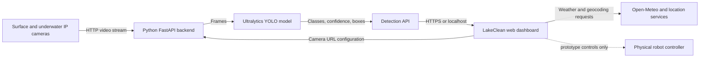

# LakeClean — Lake-Cleaning Robot Prototype

LakeClean is a student prototype dashboard for planning and monitoring a lake-cleaning robot. It combines a responsive web interface, two IP camera feeds, an optional Python YOLO inference service, and simulated mission controls. The interface is designed to demonstrate how these pieces could work together; it is not currently connected to a physical robot controller.

> **Prototype status:** Mission telemetry, robot controls, lake map hotspots, battery, solar, bin level, water measurements, and sample alerts are simulated. Live weather and the computer/browser date and time use real data. Camera images can be live. Detection boxes are real YOLO results only when Demo detections is off and the backend is connected; demo boxes are explicitly simulated.

## Features

### Dashboard and navigation

- **Overview** brings together robot status cards, the camera monitor, lake-density map, current mission, and quick controls.
- **Missions** shows the same mission state as Overview. Start, pause/resume, end, return-to-dock, and mission planning are prototype interactions.
- **Analytics** presents an environmental snapshot and detection summaries. Values shown as simulated are example data, not sensor measurements.
- **System** displays camera/system status and links to camera setup.
- Navigation is responsive for desktop and mobile screens.

### Live camera monitor and object detection

- Two independent feeds: **Surface camera** for floating waste and **Underwater camera** for submerged waste.
- Enter a camera app’s HTTP stream URL and select **Connect**. The preview appears in the matching panel. Select **Disconnect** to clear the saved URL and stop using that feed.
- The browser saves camera URLs and the selected backend address in local storage for that browser profile.
- The Python backend checks it can decode a frame when a feed is registered. It then runs YOLO and returns class name, confidence, and a normalized bounding box. Live boxes are drawn over the camera image, counts update, and new detections are recorded in the history.
- **Demo detections** is on by default. Turn it off for live inference. Demo labels and boxes are illustrative and are not AI results.
- Underwater depth is displayed only when a backend supplies calibrated numeric depth. This backend currently reports depth as unavailable.

The bundled `yolo11n.pt` model is a small, general-purpose COCO model. It can recognize common objects (for example, bottles) but is not trained specifically for lake litter. It can miss waste, label unrelated objects, or return no detections. A waste-trained model is needed for reliable litter classes; set `YOLO_MODEL` to the path of those weights before starting the backend.

### Mission planning and controls

- **Plan a mission** lets the user choose a mission name, route/area, and duration (1 to 1,440 minutes).
- Mission progress advances while running; elapsed time, remaining time, covered area, waste collected, and waypoint progress are synchronized between the Overview and Missions views.
- The demonstration area target is **2,000 sq ft**. The area and waste values are generated by the frontend for demonstration.
- **Pause** pauses the timer; **Resume** continues. **End** and **Return to dock** stop the current run and show the mission-aborted state. Starting again resets the run.
- Operating modes, the collection conveyor switch, sonar switch, and return-to-dock control demonstrate the intended control interface. These controls do not send commands to hardware.
- A sample conveyor obstruction alert demonstrates how a safety notification could be presented.

### Location, weather, and time

- The dashboard requests browser location permission and reverse-geocodes it to show a nearby locality/city and region.
- Current weather is fetched from Open-Meteo using the detected coordinates. Location and weather need internet access and location permission. If location is denied or unavailable, the app displays its fallback location/data as such.
- Date and time use the device’s local clock and time zone and update live.

### Lake overview map

The map can be expanded, closed, zoomed, and switched between surface and underwater layers. Its lake shape, hotspot positions, route/robot marker, and density legend are illustrative prototype visuals; detections are not currently geolocated onto a real lake map.

## How the robot is intended to work

This is the conceptual operating flow represented by the app. A real robot needs a physical platform, sensors, motor drivers, a control computer, power management, and tested safety logic in addition to this website.

1. **Plan:** An operator selects a route and mission duration. The robot would check its battery, bin capacity, camera/sensor health, and safety interlocks before launch.
2. **Navigate:** GPS outdoors, a compass/IMU, and obstacle sensors such as sonar would estimate position and avoid obstacles. The prototype shows a route and waypoint count but does not implement navigation.
3. **Observe:** Surface and underwater cameras provide video. The computer reads frames, resizes them for inference, and runs a waste-detection model. Each result contains a class, confidence, and bounding box in image coordinates.
4. **Decide and collect:** A real controller would filter detections by confidence and location, check that collection is safe, and command a conveyor or skimmer. The prototype displays a conveyor control but does not actuate it.
5. **Monitor:** Sensor readings would update battery, solar input, bin capacity, mission progress, and alerts. The prototype uses sample telemetry for these values. A real system should detect sensor faults, low battery, full bin, blocked conveyor, loss of localization, and communications loss.
6. **Return and stop safely:** The robot would stop collection and navigate to its dock when asked or when a safety threshold is reached. Here, Return to dock aborts the simulated mission only. Aquatic-life protection is considered an inherent safety requirement of the robot design; no separate UI toggle is provided.

### Architecture



The dotted robot link is a future integration. There is no robot-control API in this project.

## Run the local app and backend

### One-click start

1. Set up the Python environment and install the dependencies once (instructions below).
2. Double-click **Start LakeClean Backend.bat**.
3. Wait for the dashboard to open at `http://127.0.0.1:8001/`. Keep the command window open while using the app; closing it stops the service.
4. Connect the computer and both phones to the same Wi-Fi network. Start an IP camera app on each phone and enable its stream.
5. Enter each app’s actual video URL in the correct camera panel. Prefer the app’s MJPEG `/video` URL. Select **Connect**.
6. Uncheck **Demo detections**. The detection status should report live YOLO detections once frames are being read successfully.

The included batch launcher starts an existing environment; it does not install Python or packages automatically. If the `.venv` is not installed yet, install Python 3.12 and use PowerShell in the project directory:

```powershell
uv python install 3.12
uv venv --python 3.12 .venv
uv pip install --python .venv\Scripts\python.exe -r requirements.txt
```

If PowerShell blocks activation scripts, activation is not required for these commands: they call the venv’s Python directly. The model file `yolo11n.pt` is included. If using another model, point `YOLO_MODEL` at its weights file.

### Run from a GitHub Pages link

GitHub Pages hosts static HTML, CSS, and JavaScript only. It cannot install packages, start Python, run YOLO, or access a visitor’s private phone camera IP address. The dashboard’s **Inference backend connection** setting lets it call a separately running backend.

For a demo with phones on private Wi-Fi:

1. Run the backend computer and phones on the same Wi-Fi.
2. Install the Cloudflare `cloudflared` client once.
3. Double-click **Start LakeClean Public Backend.bat**. It starts the local backend in another window and prints a temporary HTTPS tunnel address.
4. Open the GitHub Pages dashboard, expand **Inference backend connection**, paste the tunnel’s HTTPS origin (no extra path), and select **Save & connect**.
5. Connect each phone camera in the dashboard and turn off Demo detections. Keep the backend and tunnel windows open during the demo. The temporary tunnel address changes when restarted.

The tunnel exposes the local backend to the internet. Treat its URL as private, use it only for a short demonstration, and stop it afterward. This prototype does not implement user authentication or production access controls. For a permanent public demo, deploy the backend with authentication and appropriate network/security controls. A cloud backend on a different network cannot directly read private URLs such as `192.168.x.x`; the backend must be on the camera network or receive a deliberately relayed stream.

## Camera and hardware notes

- The IP camera app must provide a stream readable by both the browser preview and the Python backend. HTTP MJPEG streams are the intended format. HLS, WebRTC, RTSP, credentials, and app-specific endpoints may need additional backend support.
- A green browser preview alone does not guarantee the backend can read the feed. The backend performs its own frame read when Connect is pressed. The visible status reports a registration/read failure.
- If the stream fails, confirm the full URL (including path and port), that the phone app is actively streaming, that both devices share Wi-Fi, and that the router does not isolate wireless clients. Some phones must keep the camera app open in the foreground.
- Browsers may block an HTTP camera image inside an HTTPS GitHub Pages page (mixed content) or block it due to camera CORS behavior. The Python backend may still be able to read the stream. Use a secure camera stream or a compatible secure proxy if browser preview is required.
- A phone submerged underwater will not stream reliably over Wi-Fi because radio signals do not travel reliably through water. Keep the phone above water in a waterproof mount aimed below the surface, or use a tethered underwater camera.
- Underwater metric depth requires calibrated stereo/known-size geometry or a sonar/depth sensor. A single uncalibrated camera is not enough. This project does not estimate depth.
- Do not connect this prototype to motors or a real robot without implementing and testing controller safeguards, emergency stop, sensor validation, and communications-loss behavior.

## Backend API

The FastAPI service defaults to `http://127.0.0.1:8001`:

| Endpoint | Purpose |
|---|---|
| `GET /api/health` | Reports model load state and which camera URLs are configured. |
| `POST /api/cameras/config` | Registers a surface/underwater URL after checking that a frame can be decoded; an empty URL disconnects that camera. |
| `GET /api/detections?camera=surface` | Reads a frame and returns YOLO detections for the surface feed. |
| `GET /api/detections?camera=underwater` | Reads a frame and returns YOLO detections for the underwater feed. |

Detection boxes use normalized `[x, y, width, height]` values from 0 to 1 relative to the frame. The API currently returns `depth_m: null` and `depth_calibrated: false` for both feeds. Camera URL configuration is held in backend memory and must be reconnected after a backend restart.

## Troubleshooting

| Symptom | Check |
|---|---|
| Backend URL is unreachable | Start **Start LakeClean Backend.bat** and use `http://127.0.0.1:8001` locally. For GitHub Pages, use the HTTPS tunnel origin and keep the tunnel running. |
| YOLO model failed to load | Check that `yolo11n.pt` exists in the project folder, that the venv dependencies installed, and that the model file is readable. The backend status exposes the model error. |
| Browser says stream connected, backend reports it cannot read a frame | Verify the phone app’s MJPEG `/video` endpoint and network access from the computer running Python. A browser-only feed is not sufficient for server-side inference. |
| Counts stay at zero | Turn off Demo detections, ensure the backend URL is correct, check that the feed registered, and look at the detection status for the API error. The generic model may not detect the object/class being shown. |
| Boxes do not match lake waste | YOLO boxes identify model classes in the camera image; the starter weights are generic and detections are not mapped to lake coordinates. Use a litter-trained model and add localization/calibration for map placement. |
| GitHub Pages shows a mixed-content or CORS error | Use an HTTPS backend tunnel and HTTPS camera stream/proxy where browser preview is needed. The backend still needs network access to the phone feed. |
| Underwater depth says unavailable | Expected until a calibrated depth sensor/measurement source is integrated. |

## Project files

- `index.html` — dashboard layout, navigation, mission panels, camera cards, map, and dialogs.
- `styles.css` — layout, responsive behavior, and visual design.
- `app.js` — navigation, real local clock, location/weather requests, simulated mission state, camera UI, backend polling, boxes, counts, and detection history.
- `server.py` — FastAPI endpoints, camera frame reading, YOLO inference, and static dashboard serving.
- `launch_lakeclean.py` — one-click local service launcher and browser opener.
- `Start LakeClean Backend.bat` — launches the local dashboard and inference backend.
- `Start LakeClean Public Backend.bat` — launches the local backend and a temporary public tunnel.
- `requirements.txt` — Python backend packages.
- `yolo11n.pt` — included general-purpose YOLO model weights.
